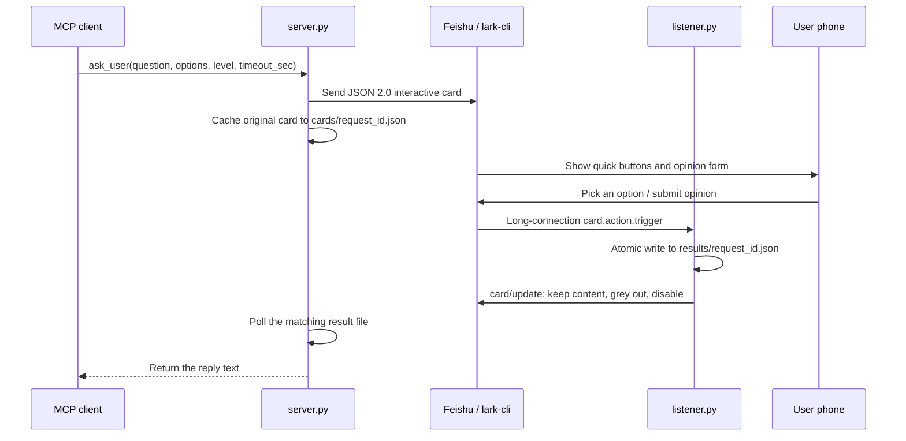

# desktop-feishu-mcp

Send an AI's confirmation questions to Feishu, tap or type a reply on your phone, and hand the answer back to the originating MCP session.

Built for local workflows where you need to step away from the computer but still want to weigh in on key decisions. Works with Claude Desktop, Claude Code, and any client that speaks local stdio MCP. The project uses only the Python standard library to drive the official [lark-cli](https://github.com/larksuite/cli) — no public server required.

> 中文说明见 [README.zh-CN.md](README.zh-CN.md)



> The implementation sends the card first and caches it on success; an extremely fast tap may briefly fall back to a simplified card for the state update, but the reply is still delivered.

## Features

- Markdown questions, quick options, and free-form opinion; notice / warning / urgent levels.
- Callbacks keyed by request ID; multiple MCP server processes can share one listener.
- After a reply, the original card is rebuilt with the question and options preserved, the reply shown, and the interaction disabled.
- Falls back to a text message plus polling when card sending fails.
- Windows, macOS, and Linux configuration and CLI discovery; foreground, background, and startup-config generation.
- Local config and environment variables; all credentials are handled by lark-cli.
- Sends an in-app urgent notification after sending the card, so it buzzes the phone even under mute.

## Prerequisites

- Python **3.10+** — no `pip install` needed.
- Node.js LTS (the npm package declares Node 16 as minimum; an actively supported LTS is recommended). The Node runtime is not required when using a native lark-cli binary.
- The official `@larksuite/cli`, with support for `im +messages-send`, `im +chat-messages-list`, `event consume card.action.trigger`, and raw `api` commands.
- A Feishu/Lark self-built app with a bot enabled, whose availability scope includes the user. Cross-tenant / international Lark deployments need their own console and CLI verification.
- The computer, listener, and MCP client stay running with network access to Feishu services.

## Installation

1. Download the repository ZIP and extract it, or clone your repository URL, then enter `desktop-feishu-mcp`. All commands below run from the project directory. On Windows you may use `py -3` instead of `python`; on macOS/Linux use `python3`.
2. Install Python and [Node.js LTS](https://nodejs.org/en/download). Reopen the terminal afterwards and check `python --version` and `node --version`.
3. Install lark-cli. The official entry point is `npx @larksuite/cli@latest install`, which runs its own setup wizard. To keep the npm package local to the project:

   ```sh
   npm install --prefix .local/deps @larksuite/cli
   node .local/deps/node_modules/@larksuite/cli/scripts/run.js --version
   ```

   The project auto-discovers this local runner. In the rest of the docs, `lark-cli` can be replaced with `node .local/deps/node_modules/@larksuite/cli/scripts/run.js`. The npm install script downloads the CLI's native binary; on failure read the terminal error, and do not mistake a successful package install for a working binary.

4. **Finish [Feishu console and authorization setup](docs/setup.md) first**: create a dedicated app, enable permissions, enable the new card callback, and publish a version. Configure the CLI under the same profile. Bot identity alone is enough to run; OAuth is the optional step for user-side operations such as auto-listing private chats.
5. Initialize config and check dependencies:

   ```sh
   python setup.py
   ```

   The wizard checks dependencies, asks for the target user and chat, generates `config.json`, prints the console steps, and generates the MCP snippet. Existing config is preserved. It does not modify the system, user-global config, or start the listener; to regenerate the snippet explicitly use `registration --replace`.

6. Check message-read and long-connection readiness:

   ```sh
   python setup.py verify
   ```

   This command sends nothing and cannot prove the callback is enabled in the console. Stop any existing listener, then run `python setup.py verify --interactive` to send a test card and tap it within 60 seconds to verify the full path.

7. Start one resident listener, and run the MCP client in another terminal:

   ```sh
   python setup.py listener --mode foreground
   ```

   Use `--mode background` to run in the background, with logs in `listener.log` and the PID in `.local/listener.pid`; a background start returning does not mean the connection is ready. `--mode startup` only generates the OS-specific autostart file — installation and removal are covered in the [setup docs](docs/setup.md#background-and-autostart). Do not run more than one listener.

## Configuration

Copy `config.example.json` to `config.json`, or run `python setup.py configure`. All relative paths are resolved against the project directory, independent of the client's working directory. Precedence: **environment variables > local config > defaults**.

| Config field | Environment variable | Notes |
| --- | --- | --- |
| `user_open_id` | `FEISHU_USER_OPEN_ID` | Users allowed to reply; leave empty to allow anyone in the target chat — suitable for a controlled group. Must not be the example placeholder |
| `chat_id` | `FEISHU_CHAT_ID` | Required; the bot's private chat or a group the bot has joined |
| `cli_config_dir` | `LARKSUITE_CLI_CONFIG_DIR` | Default `.lark-cli`; the path is only passed to the CLI — the project never opens the profile |
| `node_exe` | `FEISHU_NODE_EXE` | Optional Node path; discovered from PATH by default |
| `lark_cli_run_js` | `FEISHU_LARK_CLI_RUN_JS` | Optional path to the npm package's `scripts/run.js` |
| `lark_cli_executable` | `FEISHU_LARK_CLI_EXECUTABLE` | Optional native CLI executable path; when set it takes priority over the Node runner. Windows shell shims are not accepted |
| `results_dir` / `cards_dir` | `FEISHU_RESULTS_DIR` / `FEISHU_CARDS_DIR` | Default `results` / `cards`; server and listener must agree |
| `message_identity` | `FEISHU_MESSAGE_IDENTITY` | Default `bot`; `user` requires additional authorization; `auto` keeps the CLI's auto-selection behavior for an existing profile. Callback receive and card updates always use bot |
| `include_session_context` | `FEISHU_INCLUDE_SESSION_CONTEXT` | Default `false`; opt in to read the local Claude Code session title and last prompt and send them to Feishu |

`FEISHU_MCP_CONFIG` selects a different config file; the default is `config.json` in the project. Never put any secrets in this file. Replace the example `YOUR_OPEN_ID` / `YOUR_CHAT_ID`; set the former to an empty string when not restricting users.

CLI discovery order: explicit native path → explicit Node/JS → native CLI on PATH → common npm global/local runner. A GUI's PATH can be smaller than the terminal's; on mismatch, fill in full Node / JS paths in the local config. A profile from an old personal install also keeps working as long as the two processes agree; you may keep `auto` when migrating, but new installs are recommended to explicitly choose `bot`.

`.env` is ignored but **not auto-loaded**; use the client's `env`, system environment variables, or `config.json`.

## Registering the MCP

Run `python setup.py registration` to generate absolute-path snippets stored in the ignored `.local/`. Any supported environment overrides that were set are also written into the snippet; the server and listener should use the same config. Regenerate after moving the project, switching Python, or changing environment overrides.

### Claude Desktop

Open **Settings → Developer → Edit Config** and merge the `desktop-feishu` entry from `.local/claude-desktop.local.json` into the existing `claude_desktop_config.json` under `mcpServers`, keeping other servers. The generator does not modify your global file for you. Example:

```json
{
  "mcpServers": {
    "desktop-feishu": {
      "command": "/ABSOLUTE/PATH/TO/python",
      "args": ["/ABSOLUTE/PATH/TO/desktop-feishu-mcp/server.py"]
    }
  }
}
```

On Windows use the real Python path; JSON paths may use `/` or escaped `\\`. Quit and restart Desktop completely. Do not register the listener as an MCP server: its log output is not JSON-RPC.

### Claude Code

Run the full command in `.local/claude-code.local.txt` from PowerShell or a POSIX shell, or register manually following the [Claude Code MCP docs](https://code.claude.com/docs/en/mcp):

```sh
claude mcp add --transport stdio --scope user desktop-feishu -- /ABSOLUTE/PATH/TO/python /ABSOLUTE/PATH/TO/desktop-feishu-mcp/server.py
```

Then check the status with `/mcp` in Claude Code. The project is a synchronous stdio tool: one process handles one call at a time, and it does not implement MCP Tasks. The client's own tool timeout still applies and may fire earlier than `timeout_sec` here.

## Usage

Tell Claude: "When you need my decision, use desktop-feishu's ask_user to send the question to Feishu."

```json
{
  "question": "**Output directory check is done.** Generate the preview files now?",
  "options": ["Generate preview", "Later"],
  "level": "warning",
  "timeout_sec": 600
}
```

On the phone you can tap an option, or type in the opinion box and submit. The return value is the user's reply text. No reply returns `TIMEOUT：等待你的回复超时了。`; an empty form submit returns `(已确认)`. If an opinion was typed but a quick option is tapped, the quick option wins.

| Parameter | Default | Notes |
| --- | --- | --- |
| `question` | required | Markdown question |
| `options` | none | String array, generates quick buttons |
| `level` | `warning` | `notice` / `warning` / `urgent` |
| `timeout_sec` | `600` | Seconds to wait for a reply |

The tool returns the user's opinion to the client; whether to proceed is up to the AI client. A timeout by itself is not consent.

## Design notes and pitfalls

- Preserve the verified card **JSON 2.0** structure; the quick buttons, opinion input, and submit button all live in **one form**.
- Buttons inside the form use `form_action_type: "submit"` — do not convert them to plain behavior buttons; their `name`s are `o_<request_id>_<hex>` and `s_<request_id>`. The option is UTF-8 hex-encoded, and the listener parses it with `rsplit("_", 1)`.
- The input must not set `required`, otherwise the quick options are also blocked by required-field validation when the opinion is empty.
- `config.update_multi: true` is kept; after the callback it calls `interactive/v1/card/update` with the complete card, preserving content, using a grey header, disabling input/button, and appending the reply.
- The consume subprocess's stdin must stay open; the listener uses `PIPE` and continuously drains stderr to avoid blocking. Do not add `--quiet`; connection readiness is judged by the CLI's ready marker. See the [CLI event contract](https://github.com/larksuite/cli/blob/main/skills/lark-event/SKILL.md).
- Use a dedicated app/profile to avoid contention or callback routing conflicts with an existing message bridge; do not treat "one app can only ever have one connection" as a platform rule.
- The publish cleanup only extracts config, makes the send identity explicit, disables default session reading, restricts target user/chat, validates request IDs, writes results atomically, and trims logging; the card fields and form interaction protocol are unchanged.
- When card sending succeeds it only waits for the callback; a dropped listener does not auto-switch to text polling. Text fallback is only for card-send failure, and only suits a single outstanding question.
- After the card is sent, it calls `im.messages.urgent_app` (in-app urgent) on the target user to force a phone notification that pierces mute and per-app notification settings. This requires the app to enable the `im:message.urgent` scope (auto-approved) and publish a version; without it the urgent call fails silently and does not affect the main flow. Text fallback messages are not made urgent.

## FAQ

**Can I skip OAuth?** Yes in default bot mode; app credentials are managed through the CLI's config wizard, while app permissions still need enabling and publishing in the console. User OAuth is only needed for listing private chats and `message_identity=user`.

**Card is received but tapping gives no reply?** Check the listener log for `consume ready`; then check **Events & Callbacks → Callback Config** that the new `card.action.trigger` is added, the publish scope, that both processes use the same profile and directories, and that the configured user matches the tapper. The CLI officially states: [starting `consume` cannot detect whether the console callback switch is on](https://github.com/larksuite/cli/blob/main/skills/lark-im/references/lark-im-card-action-reply.md).

**Can't find the private-chat chat ID?** A bot's chat-list cannot enumerate private chats; after optional OAuth, run `python setup.py chats --identity user` to list the first page of user chats and pick the bot private chat; earlier chats need the CLI `--help` paging parameters. You can also read the chat ID from messages/callbacks between you and the bot in the Feishu API console. Don't pick an ordinary private chat with another person by mistake.

**Message permission errors?** Bot permissions are enabled and published in the developer console; user OAuth also requires consenting to the relevant scopes. `verify` passing the message-read test only proves that read call succeeded; sending messages and callbacks need a real tap test.

**Works in terminal but not Desktop?** Use the generated absolute Python path, and fill in the Node / runner paths in the local config; restart the client and listener. stdout must carry only MCP JSON-RPC — do not print debug info to the server's stdout.

**Can multiple people use it?** A controlled private chat is recommended. For a group, set `user_open_id` to restrict repliers; when empty, any group member's reply may be accepted. Multiple concurrent questions use different request IDs, but a single server is still synchronous.

**What is stored locally?** `cards/` keeps the question cards, `results/` temporarily stores form replies, and the server deletes the matching result after receiving it. Original cards, unconsumed/late results, and old logs are not auto-cleaned — manage them yourself. The program does not record callback tokens or full CLI responses; the CLI manages its own auth storage. Old personal logs should also stay ignored.

## Development and release

Run `python -m unittest discover -s tests -v` for offline regression; `python package.py --check` checks the to-be-published files for real identifiers / personal paths and files outside the publish manifest; `python package.py` produces `.local/dist/desktop-feishu-mcp.zip`, containing only the explicitly listed public files, without local config or message caches.

Still inspect the actual staging area before committing; `.gitignore` does not remove already-tracked files. Do not zip the whole personal directory directly. See [CONTRIBUTING.md](CONTRIBUTING.md) for the collaboration workflow and [docs/verification.md](docs/verification.md) for the test and manual-verification scope.

## License

[MIT](LICENSE). This project is independent of Feishu, Anthropic, and their official clients; Python, Node.js, lark-cli, and the clients are subject to their own licenses and terms.
