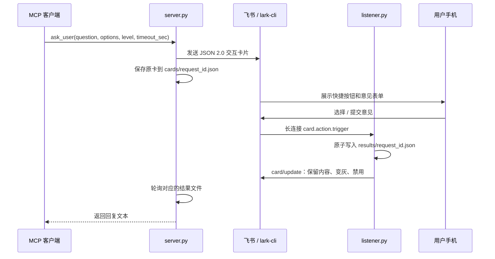

# desktop-feishu-mcp

把 AI 的确认问题发到飞书，在手机上点选或输入意见，再把回复交回原来的 MCP 会话。

适合需要离开电脑、但仍希望参与关键决定的本地工作流。支持 Claude Desktop、Claude Code 及兼容本地 stdio MCP 的客户端。项目使用 Python 标准库调用官方 [lark-cli](https://github.com/larksuite/cli)，无需公网服务器。

> English version: [README.md](README.md)



> 实际实现先发送卡片、成功后缓存原卡；极速点击可能使状态更新临时使用简化卡片，回复仍可回传。

## 功能

- Markdown 问题、快捷选项、自由意见；普通 / 警告 / 紧急三种等级。
- 按请求 ID 关联回调；多个 MCP server 进程可以共享一个 listener。
- 回复后重建原卡，保留问题和选项，显示回复并禁用交互。
- 卡片发送失败时尝试文字消息及轮询回退。
- Windows、macOS、Linux 配置和 CLI 探测；前台、后台及自启配置生成。
- 本地配置与环境变量，凭据全部交给 lark-cli 管理。

## 前置依赖

- Python **3.10+**，不需要 `pip install`。
- Node.js LTS（npm 包声明最低 Node 16；建议使用仍受支持的 LTS）。使用原生 lark-cli 时运行时可以不依赖 Node。
- 官方 `@larksuite/cli`，需要支持 `im +messages-send`、`im +chat-messages-list`、`event consume card.action.trigger` 和原始 `api` 命令。
- 一个启用机器人的飞书企业自建应用；应用可用范围包含使用者。跨租户 / 国际版 Lark 需要自行核验后台及 CLI 配置。
- 电脑、listener 和 MCP 客户端保持运行，网络能访问飞书服务。

## 安装

1. 下载仓库 ZIP 解压，或克隆你使用的仓库地址，进入 `desktop-feishu-mcp`。以下命令都在项目目录运行。Windows 可将 `python` 换成 `py -3`，macOS/Linux 可用 `python3`。
2. 安装 Python 和 [Node.js LTS](https://nodejs.org/en/download)。安装后重新打开终端，检查 `python --version`、`node --version`。
3. 安装 lark-cli。官方安装入口为 `npx @larksuite/cli@latest install`，它有自己的安装向导。若希望 npm 包仅位于项目目录：

   ```sh
   npm install --prefix .local/deps @larksuite/cli
   node .local/deps/node_modules/@larksuite/cli/scripts/run.js --version
   ```

   本项目会探测这个本地 runner。后续文档中的 `lark-cli` 可替换为 `node .local/deps/node_modules/@larksuite/cli/scripts/run.js`。npm 安装脚本会下载 CLI 原生二进制；失败时看终端错误，勿把包安装成功当成二进制已可运行。

4. **先完成 [飞书后台与授权设置](docs/setup.md)**：创建独立应用、开通权限、启用新版卡片回调、发布版本。在相同 profile 下配置 CLI。这里只要 bot 身份就能运行；OAuth 是自动列私聊等用户操作的可选步骤。
5. 初始化配置与检查依赖：

   ```sh
   python setup.py
   ```

   向导检查依赖、询问目标用户与会话、生成 `config.json`、打印后台步骤和生成 MCP 片段。已有配置会保留。不会修改系统、用户全局配置或启动 listener；需要重生成片段时显式使用 `registration --replace`。

6. 检查消息读取与长连接就绪：

   ```sh
   python setup.py verify
   ```

   此命令不发送消息，也不能证明后台已启用回调。停止已有 listener，再执行 `python setup.py verify --interactive`，确认发送测试卡并在 60 秒内点选，验证完整链路。

7. 启动一个常驻 listener，另一个终端运行 MCP 客户端：

   ```sh
   python setup.py listener --mode foreground
   ```

   想后台运行可用 `--mode background`，日志在 `listener.log`，PID 在 `.local/listener.pid`；后台启动返回不等于连接已就绪。`--mode startup` 仅生成系统对应的自启文件，安装与撤销见 [setup 文档](docs/setup.md#后台与开机自启)。不要同时运行多个 listener。

## 配置

复制 `config.example.json` 为 `config.json`，或运行 `python setup.py configure`。所有相对路径以项目目录为基准，与客户端工作目录无关。优先级：**环境变量 > 本地配置 > 默认值**。

| 配置字段 | 环境变量 | 说明 |
| --- | --- | --- |
| `user_open_id` | `FEISHU_USER_OPEN_ID` | 允许回复的用户；留空允许目标会话内任意用户，适合受控群聊。不能填示例占位符 |
| `chat_id` | `FEISHU_CHAT_ID` | 必填，机器人私聊或已加入的群聊 |
| `cli_config_dir` | `LARKSUITE_CLI_CONFIG_DIR` | 默认 `.lark-cli`；只将路径传给 CLI，本项目不打开 profile |
| `node_exe` | `FEISHU_NODE_EXE` | 可选，Node 路径；默认探测 PATH |
| `lark_cli_run_js` | `FEISHU_LARK_CLI_RUN_JS` | 可选，npm 包 `scripts/run.js` 路径 |
| `lark_cli_executable` | `FEISHU_LARK_CLI_EXECUTABLE` | 可选，原生 CLI 可执行路径；设置后优先于 Node runner，不接受 Windows shell shim |
| `results_dir` / `cards_dir` | `FEISHU_RESULTS_DIR` / `FEISHU_CARDS_DIR` | 默认 `results` / `cards`，server 与 listener 必须一致 |
| `message_identity` | `FEISHU_MESSAGE_IDENTITY` | 默认 `bot`；`user` 需要额外授权；`auto` 保留已有 profile 的 CLI 自动选择行为，回调接收和更新始终使用 bot |
| `include_session_context` | `FEISHU_INCLUDE_SESSION_CONTEXT` | 默认 `false`；可显式开启，读取本机 Claude Code 会话标题和最后提示并发到飞书 |

`FEISHU_MCP_CONFIG` 可指定其他配置文件，默认项目内 `config.json`。不要把任何密钥放进这个文件。示例里 `YOUR_OPEN_ID`、`YOUR_CHAT_ID` 需要替换；不用用户限制时将前者设为空字符串。

CLI 探测顺序：显式原生路径 → 显式 Node/JS → PATH 中原生 CLI → 常见 npm 全局/本地 runner。GUI 的 PATH 可能比终端少，遇到差异可在本地配置填完整的 Node / JS 路径。旧自用安装的 profile 也可继续使用，只需保持两进程一致；迁移旧配置时可保留 `auto`，新安装推荐明确选择 `bot`。

`.env` 被忽略但**不会自动加载**；使用客户端的 `env`、系统环境变量或 `config.json`。

## 注册 MCP

运行 `python setup.py registration` 生成本机绝对路径片段，存于被忽略的 `.local/`。设置过的受支持环境覆盖也会写入片段，server 和 listener 应使用相同配置。移动项目、换 Python 或修改环境覆盖后需重新生成。

### Claude Desktop

打开 **Settings → Developer → Edit Config**，将 `.local/claude-desktop.local.json` 中的 `desktop-feishu` 合并到现有 `claude_desktop_config.json` 的 `mcpServers`，保留其他 server。生成器不替你修改全局文件。示例：

```json
{
  "mcpServers": {
    "desktop-feishu": {
      "command": "/ABSOLUTE/PATH/TO/python",
      "args": ["/ABSOLUTE/PATH/TO/desktop-feishu-mcp/server.py"]
    }
  }
}
```

Windows 使用实际 Python 路径，JSON 路径可写 `/` 或转义为 `\\`。完全退出并重启 Desktop。不要把 listener 注册成 MCP server：它的日志不是 JSON-RPC。

### Claude Code

在 PowerShell 或 POSIX shell 中运行 `.local/claude-code.local.txt` 里的完整命令，或按 [Claude Code 官方 MCP 文档](https://code.claude.com/docs/en/mcp) 手动注册：

```sh
claude mcp add --transport stdio --scope user desktop-feishu -- /ABSOLUTE/PATH/TO/python /ABSOLUTE/PATH/TO/desktop-feishu-mcp/server.py
```

然后在 Claude Code 的 `/mcp` 查看状态。项目是同步 stdio 工具：同一进程一次处理一个调用，不实现 MCP Tasks。客户端自己的工具超时仍然生效，可能早于这里的 `timeout_sec`。

## 使用示例

告诉 Claude：“需要我决定时，用 desktop-feishu 的 ask_user 把问题发到飞书。”

```json
{
  "question": "**输出目录已检查完成**。现在生成预览文件吗？",
  "options": ["生成预览", "稍后再做"],
  "level": "warning",
  "timeout_sec": 600
}
```

手机上可以点选，或在意见框输入内容再提交。返回值是用户回复的文本。无回复则返回 `TIMEOUT：等待你的回复超时了。`；空表单提交会返回 `(已确认)`。输入了意见但点快捷选项时，以快捷选项为准。

| 参数 | 默认值 | 说明 |
| --- | --- | --- |
| `question` | 必填 | Markdown 问题 |
| `options` | 无 | 字符串数组，生成快捷按钮 |
| `level` | `warning` | `notice` / `warning` / `urgent` |
| `timeout_sec` | `600` | 等待回复的秒数 |

本工具把用户意见返回给客户端，是否继续执行操作由 AI 客户端负责；超时本身不表示同意。

## 设计说明与踩坑

- 保留已验证的卡片 **JSON 2.0** 结构；快捷按钮、意见输入框、提交按钮都在**同一个 form**。
- form 内按钮用 `form_action_type: "submit"`，不改成普通行为按钮；按钮 `name` 分别是 `o_<request_id>_<hex>` 与 `s_<request_id>`。选项用 UTF-8 hex 编码，listener 用 `rsplit("_", 1)` 解析。
- 输入框不能设置 `required`，否则没填意见时快捷选项也会被必填校验拦截。
- `config.update_multi: true` 保留；回调后调用 `interactive/v1/card/update`，发送完整卡片，保留内容、灰色标题、禁用 input/button，再附加回复。
- consume 子进程 stdin 必须保持打开；listener 用 `PIPE`，并持续读取 stderr 防止阻塞。不加 `--quiet`，连接就绪以 CLI ready 标志判断。见 [CLI 事件契约](https://github.com/larksuite/cli/blob/main/skills/lark-event/SKILL.md)。
- 使用独立 app/profile，避免和已有消息桥接进程争用或分流回调；不要把“一个应用绝对只能一条连接”当平台通则。
- 发布整理只抽取配置、明确发送身份、关闭默认会话读取、限制目标用户/会话、校验 request ID、原子写结果和减少日志；卡片字段及表单交互协议保持不变。
- 卡片发送成功时只等回调；listener 掉线不会自动切到文字轮询。文字回退只用于发送卡片失败，并且只适合单个未完成问题。

## FAQ

**可以不做 OAuth 吗？** 默认 bot 模式可以；应用凭据通过 CLI 的配置向导管理，应用权限仍需在后台开通并发布。列用户私聊和 `message_identity=user` 才需要用户 OAuth。

**卡片能收到、点击没有回复？** 检查 listener 日志是否有 `consume ready`；再检查 **事件与回调 → 回调配置** 是否添加新版 `card.action.trigger`、发布范围、两进程 profile 和目录是否一致、配置用户是否与点击者一致。CLI 官方明确说明：[consume 启动不能检测后台回调开关](https://github.com/larksuite/cli/blob/main/skills/lark-im/references/lark-im-card-action-reply.md)。

**找不到私聊 chat ID？** bot 的 chat-list 不能枚举私聊；可选 OAuth 后用 `python setup.py chats --identity user` 列出第一页用户会话，选择机器人私聊；更早会话需按 CLI `--help` 的分页参数查找。也可在飞书 API 调试台读取你与该机器人的消息/回调中的 chat ID。不要误选你与其他人的普通私聊。

**消息权限报错？** bot 权限在开发者后台开通并发布；用户 OAuth 还需同意对应 scope。`verify` 的消息读取通过只证明该读取调用成功；发消息和回调需实际点卡验收。

**命令行可用，Desktop 不可用？** 使用生成的绝对 Python 路径，并在本地配置填写 Node / runner 路径；重启客户端和 listener。stdout 只能承载 MCP JSON-RPC，不能向 server stdout 打印调试信息。

**可多人使用吗？** 推荐受控私聊。若用群聊，配置 `user_open_id` 限定回复者；留空时群内任何人的回复都可能被接受。多个并发问题用不同请求 ID，但同一个 server 仍为同步处理。

**本地存了什么？** `cards/` 保存问题卡片，`results/` 暂存表单回复，收到回复后 server 删除对应结果。原卡、未消费/迟到的结果和旧日志不会自动清理，需要自行管理。程序不记录回调 token 或完整 CLI 响应；CLI 本身的认证存储由 CLI 管理。历史自用日志也应保持忽略。

## 开发与发布

运行 `python -m unittest discover -s tests -v` 做离线回归；`python package.py --check` 检查待发布文件是否残留真实标识/个人路径及未列入发布清单的文件；`python package.py` 生成 `.local/dist/desktop-feishu-mcp.zip`，只包含明确列出的公开文件，不包括本地配置与消息缓存。

提交代码前仍需检查实际暂存区；`.gitignore` 不会移除已跟踪文件。不要直接压缩整个自用目录。具体协作流程见 [CONTRIBUTING.md](CONTRIBUTING.md)，测试与实测范围见 [docs/verification.md](docs/verification.md)。

## License

[MIT](LICENSE)。本项目独立于飞书、Anthropic 及其官方客户端；Python、Node.js、lark-cli 和客户端遵守各自的许可证与使用条款。
